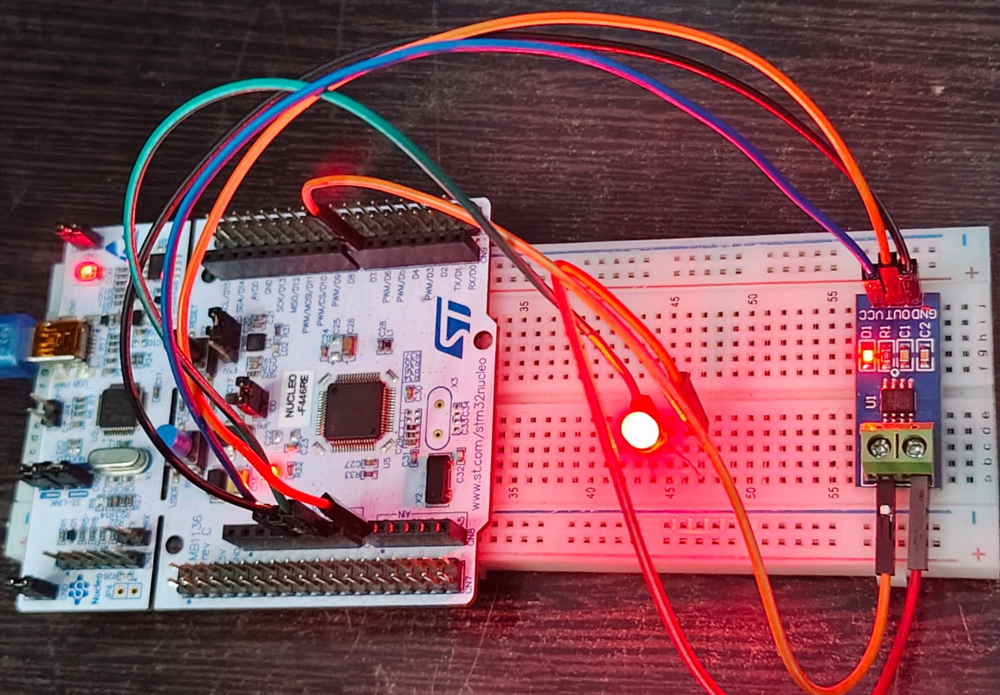
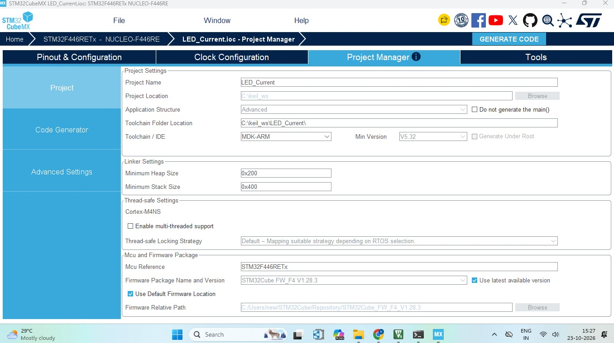
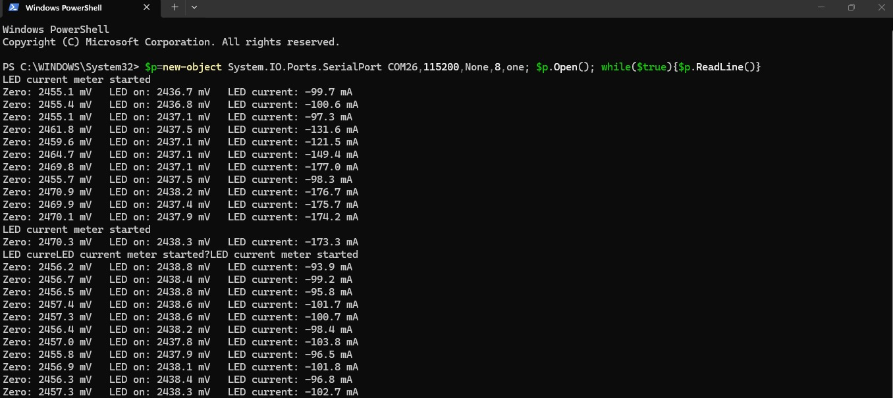

# STM32 NUCLEO-F446RE LED Current Measurement using ACS712 and Keil MDK

## Project Overview

This project measures the **current flowing through an LED** using an **ACS712 current sensor module** and the **STM32 NUCLEO-F446RE** board, and sends the result to the PC over UART.

The project was configured with **STM32CubeMX** (STM32 HAL library) and built, flashed and run with **Keil MDK (µVision)** and **Arm Compiler 6**.

The ACS712 gives an analog voltage on its OUT pin that changes with the current passing through it. The sensor output is read by the **12-bit ADC (ADC1, channel 0, pin PA0)**. The program measures the sensor voltage with the LED **OFF** (zero-current reference) and again with the LED **ON**, and the difference gives the LED current. The results are shown in a **PowerShell** window through the ST-LINK Virtual COM Port.

## Key Features

- STM32 NUCLEO-F446RE board
- ACS712 current sensor module (3-pin: VCC, GND, OUT)
- LED current measured in mA
- 12-bit ADC reading on PA0 (ADC1_IN0)
- Averaging of 2000 ADC samples per reading to reduce noise
- Automatic zero-current reference (LED OFF reading), so no manual offset calibration is needed
- LED driven from a GPIO pin (PA8 / D7)
- UART output at 115200 baud read in PowerShell, no extra terminal software needed
- Keil MDK (µVision) with Arm Compiler 6
- Programming and debugging through the on-board ST-LINK

## Hardware Required

| Component | Quantity |
| --- | --- |
| STM32 NUCLEO-F446RE board | 1 |
| ACS712 current sensor module (3-pin: VCC, GND, OUT) | 1 |
| LED | 1 |
| Current-limiting resistor for the LED | 1 |
| Jumper wires | As required |
| USB cable (data cable) | 1 |

## Circuit Connections

### Sensor Signal Connections

| ACS712 Pin | NUCLEO-F446RE Pin |
| --- | --- |
| VCC | 5V |
| GND | GND |
| OUT | PA0 (A0) |

### LED Current Path

The LED is connected in series with the current terminals of the ACS712, so the LED current flows through the sensor:

```
PA8 (D7) → ACS712 current input → ACS712 current output → Resistor → LED → GND
```

### Project Setup



## System Architecture

```
PA8 (D7) → ACS712 current path → Resistor → LED → GND
                  ↓
        ACS712 OUT (analog voltage)
                  ↓
GPIO Pin PA0 (ADC1_IN0, 12-bit ADC)
                  ↓
STM32F446RE Microcontroller
                  ↓
USART2 (PA2 TX / PA3 RX)
                  ↓
ST-LINK Virtual COM Port
                  ↓
PC (PowerShell, COM26)
```

## Pin Configuration

| Signal | MCU Pin | Mode |
| --- | --- | --- |
| ACS712 OUT | PA0 | ADC1_IN0 (analog input) |
| LED drive | PA8 (D7) | GPIO_Output |
| UART TX to PC | PA2 | USART2_TX |
| UART RX from PC | PA3 | USART2_RX |

## STM32CubeMX Configuration

1. Create a new project and select the **NUCLEO-F446RE** board in the Board Selector.
2. Initialize all peripherals with their default mode.
3. Set **PA0** as `ADC1_IN0` and enable **ADC1** channel IN0 with 12-bit resolution, software trigger, and a sampling time of **480 cycles**.
4. Set **PA8** as `GPIO_Output` for the LED.
5. Enable **USART2** in Asynchronous mode (PA2 as TX, PA3 as RX) with a baud rate of **115200**.
6. In Project Manager, set the toolchain / IDE to **MDK-ARM**.
7. Click **Generate Code**.

### Pinout & Configuration


### Project Manager



## Keil Project Setup

1. Open the generated `.uvprojx` file from the `MDK-ARM` folder in **Keil µVision**.
2. Check that the device is **STM32F446RETx**.
3. Select **Arm Compiler 6** in `Options for Target → Target`.
4. In `Options for Target → Debug`, select **ST-Link Debugger**.
5. In `Options for Target → Debug → Settings → Flash Download`, enable **Reset and Run**.
6. Add your code to `main.c`, then build and download the program.

## Code

The program is written in `main.c`. The Keil window with the source code and the program loaded into flash is shown below.

### Keil main.c and Flash Loaded


## Sensor Settings

The code has one setting that must match your ACS712 module, `SENSITIVITY_MV_PER_A`:

| ACS712 Version | Sensitivity |
| --- | --- |
| 5A | 185 mV/A |
| 20A | 100 mV/A |
| 30A | 66 mV/A |

This project uses **185 mV/A**. Other settings in the code:

| Setting | Value |
| --- | --- |
| ADC reference voltage | 3300 mV |
| ADC resolution | 12-bit (4095 counts) |
| Samples averaged per reading | 2000 |
| ADC sampling time | 480 cycles |

## Working

The program follows these steps:

1. Initialize the GPIO, USART2 and ADC1, then send `LED current meter started` to the PC.
2. Turn the LED **OFF**, wait 150 ms, and measure the sensor voltage by averaging 2000 ADC samples. This is the **zero-current voltage**.
3. Turn the LED **ON**, wait 150 ms, and measure the sensor voltage again.
4. Calculate the current from the voltage change:

```
Current (mA) = (LED ON voltage - Zero voltage) / Sensitivity × 1000
```

5. Send the zero voltage, the LED-on voltage and the LED current to the PC.
6. Wait 1.5 seconds and repeat.

```
LED OFF → measure zero → LED ON → measure → calculate current → UART output → wait 1.5 s → repeat
```

### ADC Voltage Conversion

```
Voltage (mV) = Average ADC count × 3300 / 4095
```

The ACS712 output sits near half of its supply voltage (about 2.5 V on a 5 V supply) when no current flows. Measuring this zero level with the LED OFF in every cycle removes the need for manual offset calibration.

## Serial Output

The ST-LINK on the Nucleo board provides a Virtual COM Port, so no extra USB-to-serial adapter is needed. Check the COM port number in **Device Manager** (this project used **COM26**).

Run this command from the Windows Run dialog (`Win + R`) or Command Prompt to open a PowerShell window that stays open:

```powershell
powershell -NoExit -Command "$p=new-object System.IO.Ports.SerialPort COM26,115200,None,8,one; $p.Open(); while($true){$p.ReadLine()}"
```

If you are already inside a PowerShell window, run only the inner part:

```powershell
$p=new-object System.IO.Ports.SerialPort COM26,115200,None,8,one; $p.Open(); while($true){$p.ReadLine()}
```

| Setting | Value |
| --- | --- |
| Port | COM26 (change to match your PC) |
| Baud rate | 115200 |
| Data bits | 8 |
| Parity | None |
| Stop bits | 1 |

Press `Ctrl + C` to stop reading. Run `$p.Close()` before opening the port again.

## Output

The PowerShell window shows a start message, then a new reading about every 2 seconds. Each line gives the sensor voltage with the LED off, the sensor voltage with the LED on, and the calculated LED current.

Message format:

```
LED current meter started
Zero: <value> mV   LED on: <value> mV   LED current: <value> mA
```

### PowerShell Serial Output



## How to Run

1. Connect the ACS712, LED and resistor to the board as shown in the circuit connections.
2. Connect the board to the PC with a USB cable.
3. Open the `.uvprojx` file in **Keil µVision**.
4. Build the project with **F7**.
5. Download the program to the board with **F8**.
6. Press the black **Reset** button if the program does not start.
7. Open PowerShell and run the serial command above.

## Testing

| Test | Result |
| --- | --- |
| Build in Keil (Arm Compiler 6) | Successful |
| Flash through ST-LINK | Successful |
| ADC reading of ACS712 output on PA0 | Working |
| Zero-current voltage (LED OFF) | Displayed |
| LED current in mA | Displayed |

## Important Notes

### Jumpers

Both **CN2** jumper caps on the board must be fitted. If they are missing, the programmer cannot connect to the chip.

### Sensor Version

Set `SENSITIVITY_MV_PER_A` in `main.c` to match your ACS712 module (5A, 20A or 30A). A wrong value gives a wrong current.

### Accuracy

The 5A version of the ACS712 changes by only 185 mV per amp, so a small LED current of a few mA produces a very small voltage change (about 1 mV per 5 mA). One ADC step is about 0.8 mV, so the readings are approximate. Averaging 2000 samples improves stability, but this sensor is better suited to larger currents. For high accuracy at small currents, compare the result with a multimeter.

### Current Direction

The sign of the result depends on the direction in which the current flows through the sensor. If the current reads negative, swap the two current terminals of the ACS712.

### Regenerating Code in CubeMX

If you regenerate the code, check that PA0 is still set as `ADC1_IN0` and that your own code is still inside the `USER CODE BEGIN` and `USER CODE END` blocks.

### COM Port

The COM port number can change between PCs or USB ports. Always check Device Manager before running the PowerShell command.

### One Program at a Time

Only one program can use the COM port at once. Close any other serial terminal before running the PowerShell command.

### USB Cable

Use a data-capable USB cable. Some cables only charge.

## Technologies and Concepts

- STM32 NUCLEO-F446RE
- STM32CubeMX
- Keil MDK (µVision)
- Arm Compiler 6
- STM32 HAL library
- ACS712 Hall-effect current sensor
- ADC (12-bit, polling mode)
- ADC sample averaging
- GPIO output
- UART communication
- ST-LINK Virtual COM Port
- PowerShell serial reading
- ST-LINK programming and debugging

## Future Improvements

- Show the current on a 16×2 I2C LCD
- Measure larger loads such as a motor or a bulb
- Use an INA219 module for better accuracy at small currents
- Use a timer-triggered ADC with DMA instead of polling
- Add a current threshold alert using LEDs
- Send the readings to a mobile app or IoT dashboard

# 🎥 Project Video

[▶️ Watch the LED Current Measurement Demonstration](https://drive.google.com/file/d/1D8DsAuOfsa5vw_B9_87zVHra1TV__abI/view?usp=drivesdk)
